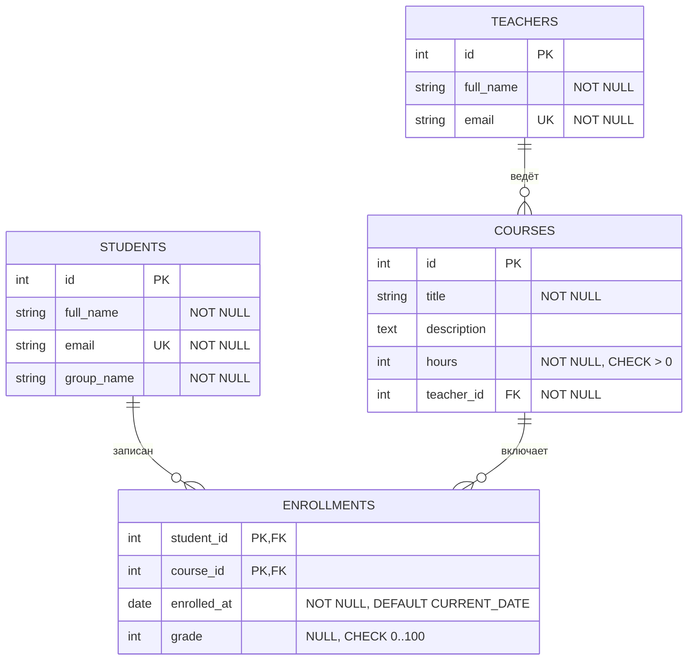

# lab-db: «Учебный центр» (PostgreSQL, Sequelize, REST API)

Лабораторная работа: проектирование схемы БД, SQL в облачной PostgreSQL (Neon), ORM Sequelize и REST API на Node.js + Express.

## Структура проекта

```
sql/schema.sql    — CREATE TABLE с ключами и ограничениями
sql/seed.sql      — тестовые данные (4–5 записей в каждой таблице)
sql/queries.sql   — запросы (SELECT, JOIN, GROUP BY, подзапрос, UPDATE/DELETE, транзакции, бонус с индексом)
src/db.js         — подключение Sequelize и модели
src/test.js       — проверка моделей (node src/test.js)
src/server.js     — REST API (node src/server.js)
.env.example      — пример файла .env (сам .env не коммитится)
```

## Часть 1. Схема БД

### Сущности и связи

- **teachers** — преподаватели.
- **courses** — курсы. Связь «один ко многим»: у курса один преподаватель (`courses.teacher_id`), у преподавателя много курсов.
- **students** — студенты.
- **enrollments** — записи на курсы. Связующая таблица для связи «многие ко многим» между студентами и курсами; хранит дату записи и оценку.

### Ограничения

| Таблица | PRIMARY KEY | FOREIGN KEY | NOT NULL | UNIQUE | CHECK |
|---|---|---|---|---|---|
| teachers | `id` | — | `full_name`, `email` | `email` | — |
| courses | `id` | `teacher_id → teachers(id)` | `title`, `hours`, `teacher_id` | — | `hours > 0` |
| students | `id` | — | `full_name`, `email`, `group_name` | `email` | — |
| enrollments | `(student_id, course_id)` | `student_id → students(id)`, `course_id → courses(id)` | `student_id`, `course_id`, `enrolled_at` | — (обеспечивает составной PK) | `grade BETWEEN 0 AND 100` |

`grade` допускает `NULL`: пока оценка не выставлена, поле пустое. Составной первичный ключ не даёт записать одного студента на один курс дважды. При удалении курса или студента его записи удаляются каскадно; преподавателя, у которого есть курсы, удалить нельзя (`ON DELETE RESTRICT`). Колонка группы названа `group_name`, потому что `group` — зарезервированное слово SQL.

### ER-диаграмма



Связь «многие ко многим» STUDENTS — COURSES реализована через связующую таблицу ENROLLMENTS (две связи «один ко многим»).

### Почему схема в третьей нормальной форме

Все атрибуты атомарны (одно значение в ячейке, без списков курсов в строке студента), поэтому схема в 1НФ. В `teachers`, `courses` и `students` ключ простой (`id`), а в `enrollments` неключевые атрибуты `enrolled_at` и `grade` зависят от всей пары `(student_id, course_id)`, а не от её части: дата записи и оценка относятся к конкретному студенту на конкретном курсе. Значит, частичных зависимостей нет и выполняется 2НФ. Транзитивных зависимостей тоже нет: в `courses` хранится только `teacher_id`, а ФИО и email преподавателя лежат в `teachers`, поэтому ни один неключевой атрибут не зависит от другого неключевого атрибута, и схема находится в 3НФ.

## Часть 2. SQL

Выполнение в Neon: **SQL Editor** → вставить содержимое файла → **Run**. Порядок: `schema.sql`, `seed.sql`, затем `queries.sql` (запросы можно запускать по одному, выделяя нужный фрагмент).

В `queries.sql`:

1. `SELECT` с `WHERE`, `ORDER BY`, `LIMIT` — курсы длиннее 30 часов;
2. `INNER JOIN` курсов и преподавателей;
3. `LEFT JOIN` — курсы без записей (в тестовых данных это «Python для анализа данных»);
4. `JOIN` трёх таблиц: студент, курс, оценка;
5. `GROUP BY` + `HAVING` — средняя оценка по курсам выше 70;
6. подзапрос — оценки выше средней по всем записям;
7. `UPDATE` и `DELETE` с условием;
8. транзакции: запись на курс и выставление оценки с `COMMIT` и пример с `ROLLBACK`;
9. **бонус:** `EXPLAIN ANALYZE` до и после `CREATE INDEX`.

Результат бонуса в Neon (100 000 тестовых студентов, поиск по ФИО `'Студент 77777'`):

| | План | Execution time | Planning time |
|---|---|---|---|
| без индекса | `Seq Scan on students` (просматривается вся таблица) | 5,12 мс | 0,09 мс |
| с индексом `idx_students_full_name` | `Index Scan using idx_students_full_name` | 0,064 мс | 0,186 мс |

С индексом запрос выполнился примерно в 80 раз быстрее. Индекс позволяет не просматривать всю таблицу, а сразу найти нужную строку по B-дереву. На 5 строках разницы не видно: PostgreSQL всё равно выберет Seq Scan, поэтому в бонусе таблица сначала наполняется данными через `generate_series`, а в конце тестовые данные удаляются.

> Перед частями 3–4 заново выполните `schema.sql` и `seed.sql`, так как `queries.sql` изменяет данные.

## Часть 3. ORM (Sequelize)

Модели в `src/db.js` описаны поверх готовой схемы (`tableName`, `underscored: true`, `timestamps: false`), поэтому `sequelize.sync()` не нужен. Связи:

- `Teacher.hasMany(Course)` / `Course.belongsTo(Teacher)` по `teacherId`;
- `Student.belongsToMany(Course)` / `Course.belongsToMany(Student)` через `Enrollment`;
- у `Enrollment` составной первичный ключ: `primaryKey: true` у `studentId` и `courseId`.

```bash
node src/test.js
```

Скрипт выводит курсы с преподавателями, студентов курса с оценками, добавляет студента, меняет оценку и удаляет запись. Его можно запускать повторно: тестовый студент в конце удаляется.

## Часть 4. REST API

```bash
node src/server.js
```

| Метод | URL | Описание | Коды ответа |
|---|---|---|---|
| GET | `/courses` | все курсы с преподавателем | 200 |
| GET | `/courses/:id` | один курс | 200, 400, 404 |
| POST | `/courses` | создать курс `{title, hours, teacherId, description?}` | 201, 400 |
| PUT | `/courses/:id` | изменить курс (любые из полей) | 200, 400, 404 |
| DELETE | `/courses/:id` | удалить курс | 200, 400, 404 |
| POST | `/enrollments` | записать студента `{studentId, courseId, grade?}` | 201, 400, 404, 409 |
| GET | `/students/:id/courses` | курсы студента с оценками | 200, 400, 404 |

Проверка входных данных: `id` — положительное целое; `title` — непустая строка; `hours` — целое больше 0; `grade` — целое 0–100 или `null`; некорректный JSON даёт 400. Если преподаватель не существует, ответ 400, если студент или курс не найден — 404, повторная запись на тот же курс — 409.

Проверка через curl во втором терминале (Windows, Command Prompt):

```bat
curl http://localhost:3000/courses
curl -i -X POST http://localhost:3000/courses -H "Content-Type: application/json" -d "{\"title\":\"SQL\",\"hours\":40,\"teacherId\":1}"
curl -i -X PUT http://localhost:3000/courses/6 -H "Content-Type: application/json" -d "{\"hours\":44}"
curl -i -X POST http://localhost:3000/enrollments -H "Content-Type: application/json" -d "{\"studentId\":2,\"courseId\":6}"
curl -i -X POST http://localhost:3000/enrollments -H "Content-Type: application/json" -d "{\"studentId\":2,\"courseId\":6}"
curl -i -X POST http://localhost:3000/courses -H "Content-Type: application/json" -d "{\"title\":\"\",\"hours\":0}"
curl -i -X DELETE http://localhost:3000/courses/6
```

Полученные результаты:

| Запрос | Код ответа | Ответ |
|---|---|---|
| `GET /courses` | 200 OK | 5 курсов вместе с преподавателем (`Teacher`) |
| `POST /courses` | 201 Created | `{"id":6,"title":"SQL","hours":40,"teacherId":1,"description":null}` |
| `PUT /courses/6` | 200 OK | `{"id":6,"title":"SQL","description":null,"hours":44,"teacherId":1}` |
| `POST /enrollments` | 201 Created | `{"enrolledAt":"2026-11-18","studentId":2,"courseId":6,"grade":null}` |
| `POST /enrollments` (повторно) | 409 Conflict | `{"error":"Такая запись уже существует"}` |
| `POST /courses` (пустые данные) | 400 Bad Request | `{"errors":["title: непустая строка","hours: целое число больше 0","teacherId: положительное целое"]}` |
| `DELETE /courses/6` | 200 OK | `{"message":"Курс 6 удалён"}` |

## Запуск с нуля

1. Установить Node.js (nodejs.org, версия LTS).
2. Создать в корне проекта файл `.env` по образцу `.env.example` и вставить строку подключения из Neon (кнопка **Connect**).
3. В терминале:

```bat
npm install
node src/test.js
node src/server.js
```

Файл `.env` содержит пароль от базы и не коммитится (он есть в `.gitignore`).